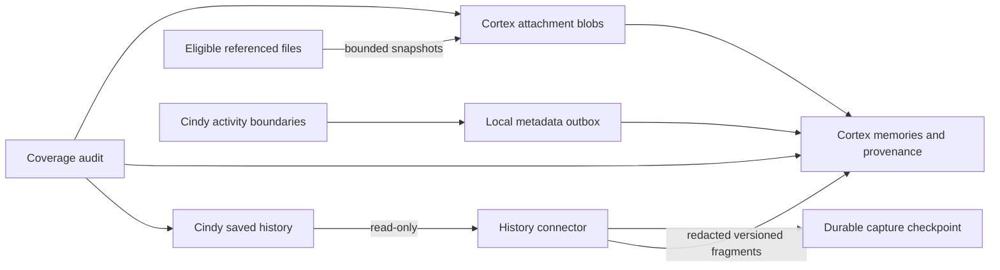

<p align="center"></p>

# Xibalba Cortex for Cindy

**Persistent memory and verifiable capture of the activity Cindy retains.**

**Plugin:** `xibalba-cortex` · **Version:** `0.3.6` · **Minimum Cindy:** `0.1.115` · **Status:** local integration pilot

Cortex for Cindy connects [Cindy](https://github.com/makecindy/cindy) to the [Xibalba Cortex](https://github.com/XibalbaTechSol/xibalba-cortex) memory backend. It provides tools for remembering, recalling, inspecting provenance, and verifying memory history. Optional recording archives saved conversations, tool calls and results, questions, plans, and background-session messages into a dedicated local Cortex profile.

Optional file snapshots preserve supported attachments and task artifact references as content-addressed blobs. Optional activity capture records thinking, approval, user-input, and turn boundaries as metadata. A coverage audit compares the retained source history with the archive instead of assuming that an enabled recorder has captured everything.

The plugin is an integration with an existing Cortex installation. It does not install the Python backend, replace Cindy's built-in memory system, or expose private model reasoning.

**[Download the installable package](dist/xibalba-cortex-0.3.6.cindy)** · **[Checksums](dist/SHA256SUMS)** · **[Backend installation](https://github.com/XibalbaTechSol/xibalba-cortex#quick-start)** · **[Report an issue](https://github.com/XibalbaTechSol/cortex-cindy/issues)**

## Contents

- [Capabilities and boundaries](#capabilities-and-boundaries)
- [Requirements and compatibility](#requirements-and-compatibility)
- [Installation](#installation)
- [Local Cortex setup](#local-cortex-setup)
- [Hosted Cortex setup](#hosted-cortex-setup)
- [Recording modes](#recording-modes)
- [File snapshots](#file-snapshots)
- [Thinking and other activity metadata](#thinking-and-other-activity-metadata)
- [Tool reference](#tool-reference)
- [Verify capture](#verify-capture)
- [Storage, fidelity, and recovery](#storage-fidelity-and-recovery)
- [Privacy, permissions, and trust](#privacy-permissions-and-trust)
- [Diagnostics and troubleshooting](#diagnostics-and-troubleshooting)
- [Updates, pause, and removal](#updates-pause-and-removal)
- [Development and validation](#development-and-validation)
- [Packaging and distribution](#packaging-and-distribution)
- [Version history](#version-history)
- [License](#license)

## Capabilities and boundaries

| Activity | What Cortex can retain | Boundary |
| --- | --- | --- |
| Explicit memories | User-requested facts, source locators, lifecycle state, and provenance | New records are candidates; Cortex may quarantine suspicious content. |
| User prompts | Persisted user-message content and attachment descriptors | Messages that Cindy never saves, or deletes before capture, cannot be recovered. |
| Assistant responses | Persisted assistant text, including visible progress messages | The recorder preserves the source version available at capture time. |
| Tool calls | Persisted tool names, inputs, and tool-call identifiers | A tool call is evidence of an invocation, not proof an action succeeded. |
| Tool results | Persisted result text or JSON and its source identifiers | Source-side truncation and omitted outputs cannot be reversed. |
| Questions and plans | Persisted `ask_user` and `plan_review` messages | The connector supports the installed schema's documented role allowlist. |
| Background sessions | Supported saved messages, including parent-session and worker metadata | Local history capture covers the selected account database; hooks alone do not cover background sessions. |
| Files | Optional byte snapshots of explicit attachments and eligible artifact references | Files must be identifiable from supported references and pass the limits below. No filesystem-wide recording. |
| Thinking/activity | Optional start/end identifiers, timestamps, and available model/agent/duration fields | Private reasoning text is excluded. |
| Memory verification | Local event-chain checks and persisted retrieval traces | Does not establish truth, complete capture, on-chain anchoring, or regulatory certification. |

**Coverage is bounded by what Cindy retains and the connector supports.** This is not lossless capture of every application event, OS filesystem change, remote machine, or provider-internal execution step. Read the [coverage audit](#verify-capture) before making completeness claims.

## Requirements and compatibility

| Component | Requirement |
| --- | --- |
| Cindy | Version `0.1.115` or later; manifest schema 3 support. |
| Node runtime | Supplied by Cindy for the bundled native worker. Users do not run `npm install` for this plugin. |
| Local backend | An installed, working Cortex executable and its Python environment. The backend currently requires Python 3.12 or later. |
| Backend dependencies | Follow the [Cortex repository setup](https://github.com/XibalbaTechSol/xibalba-cortex). Its current `integrity-sdk` dependency uses the documented sibling `integrity-core` checkout; standalone PyPI installation is not claimed. |
| Identity | A valid profile-scoped `agent.did.json`, or an existing explicit agent DID override. |
| History source | An explicitly selected, supported local Cindy SQLite history database. |
| Filesystem | Read access to selected source history and eligible files; write access to the Cortex destination profile. |
| Hosted tools | A reachable HTTPS streamable-HTTP MCP endpoint and a valid bearer credential with appropriate agent binding and scopes. |

The implementation and integration checks have been exercised on Linux. File handling uses POSIX facilities, including `O_NOFOLLOW` and file modes; Windows portability is not established. macOS and other host combinations require their own canary before claiming support.

Executable and profile paths start empty. **Set your own absolute paths after installation.** Existing saved settings are preserved; the plugin does not discover or select another user’s profile.

## Installation

1. Download [`xibalba-cortex-0.3.6.cindy`](dist/xibalba-cortex-0.3.6.cindy). On GitHub's file page, download the raw file rather than saving the rendered page.
2. Optionally verify it against [`SHA256SUMS`](dist/SHA256SUMS):

   ```bash
   sha256sum xibalba-cortex-0.3.6.cindy
   ```

3. Open Cindy's **Plugins** settings and import the `.cindy` file.
4. Review Cindy's permission disclosure and enable the plugin.
5. Open the plugin settings and configure the connection before enabling recording.
6. Click **Test saved connection**, or ask: `$cortex Check the connection and recording status.`

A successful installation or a "ready" setup card does not prove backend connectivity. A successful `memory_status` call does. Likewise, a successful connection test does not prove that message capture or file archival is complete.

New installs default to recording paused, history capture disabled, file snapshots disabled, and activity metadata disabled. Updates preserve the existing settings, so an updated installation may already be recording.

The package is a locally distributable pilot artifact. A GitHub download is not proof of a Cindy marketplace listing, a verified publisher, or a reviewed release.

## Local Cortex setup

### 1. Prepare an isolated destination

Use a dedicated Cortex profile for Cindy. Avoid accidentally sharing an inference-worker, trading, or unrelated agent profile. Follow the backend and Integrity SDK's supported identity-provisioning workflow to create the profile's public `agent.did.json`; keep private keys in their designated key store.

This plugin does not generate a production identity for you, import a private key through chat, or disable agent scoping. An explicit DID override must refer to an identity you already manage. When it is blank, Cortex resolves the selected profile's DID file.

### 2. Save the connection

| Setting | Example | Meaning |
| --- | --- | --- |
| Connection | `Local Cortex` | Launch the installed backend through stdio MCP. |
| Cortex executable | `/absolute/path/to/xibalba-cortex/.venv/bin/xibalba-cortex` | Existing executable; not a shell command or an `uv run` string. |
| Profile directory | `/absolute/path/to/dedicated-cindy-profile` | Cortex's destination store and configuration. |
| Agent DID override | Empty, or your existing public DID | Empty uses the selected profile's DID file. |

Save the settings and run **Test saved connection**. Local execution removes inherited `XIBALBA_CORTEX_ALLOW_UNSCOPED_STDIO` and unrelated `XIBALBA_AGENT_ID` values; the configured override, if present, is supplied for that request.

The agent can also call the following tool. Tool examples throughout this document are **argument objects for Cindy tools, not shell commands**:

```json
{
  "tool": "cortex_configure_local",
  "args": {
    "executable": "/absolute/path/to/xibalba-cortex/.venv/bin/xibalba-cortex",
    "home": "/absolute/path/to/dedicated-cindy-profile"
  }
}
```

`cortex_configure_local` checks `memory_status` before saving the new connection. A failed test leaves the previous connection settings in place. It preserves the recording toggle and saved hosted credentials.

### 3. Enable persisted history capture

In plugin settings, enable recording, select **Capture persisted session activity**, and provide the current account's local Cindy history database path. The agent-facing setup tool can validate that the chosen database contains the expected current session before saving it:

```json
{
  "tool": "cortex_configure_history",
  "args": {
    "database": "/absolute/path/to/your-account-cindy-history.db",
    "enabled": true,
    "session_id": "your-current-cindy-session-id"
  }
}
```

Do not guess the account database or select another account's file. The connector never searches other account databases automatically. It opens the selected source using SQLite `mode=ro` and `PRAGMA query_only=ON`, validates required columns, and stops on unsupported schemas.

### 4. Enable the additional capture options

```json
{
  "tool": "cortex_configure_capture",
  "args": {
    "archive_files": true,
    "activity_metadata": true
  }
}
```

These options require local mode, recording enabled, and history capture enabled. Their settings-page equivalents are **Preserve attached files and task artifacts** and **Record activity boundary metadata**.

Run `cortex_sync_history` for a bounded catch-up sweep, then `cortex_capture_audit`. Large histories need multiple sweeps; an individual sweep finishing is not equivalent to a complete initial backfill.

## Hosted Cortex setup

Hosted mode supports the explicit memory tools over authenticated HTTPS MCP. The local SQLite-history connector, file snapshots, and activity outbox delivery require local Cortex and are not a hosted-history-upload service.

1. Deploy and secure a Cortex streamable-HTTP MCP endpoint following the backend's deployment guidance.
2. Select **Hosted Cortex** and enter the complete HTTPS MCP URL, such as `https://your-cortex-host.example/mcp`.
3. Enter the bearer token in the plugin's protected password field and save it.
4. Test `cortex_status`; use a credential that is valid for the intended agent and operations.

The endpoint must not contain embedded credentials, query parameters, or a fragment. Requests do not follow redirects. The worker initializes an MCP session per request and attempts to close it afterward when supported. The backend's built-in HTTP listener does not itself provide TLS; remote deployment requires an appropriate TLS-terminating endpoint.

Tokens are saved through Cindy's vault rather than `/kv`, agent arguments, or logs. Only the declared `hosted/call` worker method receives the token for that request. A blank password field retains the saved token; **Remove saved token** deletes it. Rotate and revoke tokens through your backend's supported credential-management workflow.

Prefer finite-lived credentials with the required scopes. Read tools require appropriate read access; remembering requires write access. Do not paste credentials into chat or use the tenant-onboarding command as though it also provisioned an agent DID.

**Hook-only mode can send conversation text to the selected hosted endpoint if recording is enabled.** Keep recording paused when hosted mode should be used only for explicit tools. Hosted credentials do not grant automatic access to a local Cindy database.

## Recording modes

### Explicit tools only

Leave recording paused. The agent can remember and recall when requested, inspect traces, and verify memory chains. No automatic conversation or history recording is enabled by this mode.

### Conversation hooks

With recording enabled and history capture disabled, resident user/assistant hooks immediately return `allow` and enqueue best-effort text capture. They do not rewrite or block the conversation. User messages, including additional messages in a running turn, are paired with the next assistant hook for that session.

Hook limits:

- At most 32 pending sessions, a 64-event queue, and 60,000 characters per side.
- Pending message text exists only in memory. A restart or configuration reset can lose the pending correlation.
- There is no durable raw-text spool or automatic replay for hook captures.
- Cindy does not supply a shared turn identifier for this pairing; overlapping activity in one session can be ambiguous.
- Tool payloads, files, background sessions, and private reasoning are not supplied by these text hooks.

Hook mode records known skip reasons; it is not a substitute for persisted history capture.

### Persisted history capture

With recording and history capture enabled, the hook text recorder yields to the SQLite-history connector to avoid recording each message through both routes. The connector imports the six supported saved message roles across the selected account's non-deleted sessions, including saved background-session activity.

Automatic sweeps run after a 15-second interval following the previous polling work. Each sweep handles at most 100 supported source records and checks a soft 25-second budget between records, between files, and between file-copy chunks. Incomplete file work retains a per-message checkpoint and resumes on a later sweep; already completed files are not copied again when their securely opened device/inode/mode/size/mtime/ctime fingerprint is unchanged. The budget is cooperative and cannot interrupt a single blocked OS read or backend call. A full scan takes multiple batches; new capture and edit detection are therefore eventually consistent, not instant or governed by a subsecond SLA.

The source connector is tied to the supported installed SQLite schema. It is not a claim that Cindy provides a stable public database-export API. Host updates need a compatibility check.

## File snapshots

### Discovery

When enabled, file archival considers:

- Explicit path descriptors in persisted `user.files` and `user.images`, using supported `path`, `filePath`, `url`, or `src` fields.
- Absolute Markdown file/artifact links in saved assistant text.
- Recognized structured tool-result fields: `cindyPath`, `output_path`, `artifact_path`, and `saved_path`.
- Supported local `file://` references and managed `cindy-media://blobs/<hash>.<ext>` references.

It does not crawl folders, inspect every path embedded in a command or free-form tool output, fetch arbitrary URLs, or treat every referenced file as an agent-created artifact. Inline data and other formats are not separately decoded into blob attachments by this snapshot resolver; any such data retained in supported message content remains part of that message archive.

### Scope and limits

| Rule | Current behavior |
| --- | --- |
| Maximum file size | 50 MiB per snapshot. |
| Maximum references | 64 discovered references per source record per sweep. |
| Generated/reference roots | Recorded local task working directory, or `~/Projects`, `~/Pictures`, `~/Documents`, `~/Desktop`. |
| Explicit attachments | May be outside generated-artifact roots, subject to other checks. |
| Local workspace kinds | Known local `dialogue`/`local` workspaces; remote-host identifiers prevent treating remote paths as local. |
| Symlinks | Excluded by the resolver. |
| File types | Regular files only; no device, socket, FIFO, or directory snapshots. |
| Credentials | Recognized credential paths are excluded; this is a narrow guard, not a complete sensitive-data classifier. |
| Mutable files | A detected change during the read causes a status record instead of accepting the copy. |
| Remote resources | Unsupported references are recorded, not downloaded. |

The resolver currently excludes names such as `.env`, `id_rsa`, `id_ed25519`, `credentials`, and `credentials.json`; `.pem`/`.key` files; and recognized credential-directory segments. Do not interpret this list as a guarantee that every other file is safe to archive.

### Storage and provenance

Each attempted reference produces a manifest with its source relationship and a status. Every path component is opened relative to a held directory descriptor with symlink following disabled, including for explicitly attached files. Successful snapshot records are stored separately from the latest source-availability attempt, so a later missing/error result does not erase the archived hash or memory ID. Successful snapshots include SHA-256, size, media type, and an attachment linked to a Cortex memory. Bytes are copied through a private temporary file into Cortex's content-addressed blob store. Identical bytes share blob storage, and a completed replay checks for an existing matching attachment before adding one.

The snapshot means **bytes available when the recorder read the file**. It does not prove those were the bytes originally created or first attached. Rescans can archive a later version while retaining earlier records.

**Original file bytes are not secret-redacted.** Textual message and manifest envelopes use Cortex's redactor; arbitrary binary/text attachments are preserved as bytes. Their contents are not automatically OCRed, transcribed, summarized, or semantically indexed.

Status values include `archived`, `missing`, `permission_denied`, `size_limit`, `changed_during_read`, `file_read_failed`, `not_regular_file`, `unsupported_reference`, `relative_reference`, `remote_reference`, `outside_artifact_roots`, `symlink_reference`, and `credential_path`. Excess or unattempted references remain visible in coverage reporting. A retained reference alone is not a preserved file copy. Sweep counters also report `reused_snapshots` and `deferred` file work. The audit can verify an earlier archived blob even while the latest attempt reports that its original source is missing.

## Thinking and other activity metadata

The plugin subscribes to Cindy's `turn` and `activity` topics. Supported metadata events are:

```text
did-thinking-start       did-thinking-end
did-approval-start       did-approval-end
did-user-input-start     did-user-input-end
did-turn-start           did-turn-end
```

Only allowlisted scalar fields are copied: session ID, event name and timestamp, opaque block/request identifiers, and available agent, model, duration, and end reason. Arbitrary event data, prompt bodies, tool inputs, and thought text are not copied into this metadata channel.

Visible plans, explanations, and progress updates are retained through normal saved-message capture. **Private model reasoning is not captured.** Thinking start/end records describe an activity boundary, not the content of that reasoning.

A local outbox holds at most 512 metadata events and retries delivery in batches of 20. Entries are bound to the selected profile, agent override, and history database, so changing destinations does not silently route old entries to a different store. Successful delivery removes the entries; failed delivery retains them when storage is available. Queue, storage, and import failures are diagnosed.

Activity subscriptions cover the boundaries Cindy actually delivers. They are not a replay source for every missed boundary or a guarantee of background-event coverage. Browser storage clearing, overflow, and host event drops can still cause loss.

## Tool reference

Use `$cortex` to ask Cindy to select the appropriate tool. For example:

> `$cortex Check the connection, run a history sweep, and report capture coverage.`

> `$cortex Remember this project decision with its source, then recall it and verify its memory history.`

| Tool | Arguments | Result and boundary |
| --- | --- | --- |
| `cortex_status` | `{}` | Real backend `memory_status`, recording mode, history progress/error, file setting, activity queue, and recent diagnostics. |
| `cortex_remember` | `content`, `locator`; optional `evidence_class` | Stores a candidate with explicit provenance. Allowed evidence classes: `observed_event` (default), `inference`. Suspicious content may be quarantined. |
| `cortex_recall` | `query`; optional `limit` | Hybrid retrieval over candidate/active/confirmed memories. Default limit 5, maximum 20, total character budget 16,000. Returns provenance and a persisted retrieval trace when supplied by Cortex. |
| `cortex_verify` | `memory_id` | Checks one memory's local event chain. Does not prove truth or on-chain anchoring. |
| `cortex_trace` | `trace_id` | Reads a previously persisted retrieval trace. |
| `cortex_configure_local` | `executable`, `home`; optional `agent_id` | Tests an existing local connection before saving it. |
| `cortex_configure_history` | `database`, `enabled`; `session_id` needed when enabling | Configures read-only history capture after validation. Recording must already be enabled. |
| `cortex_configure_capture` | `archive_files`, `activity_metadata` | Sets explicit local file/activity options without changing the recording toggle. |
| `cortex_sync_history` | `{}` | Flushes an eligible activity batch and requests one bounded history sweep; may return `busy`. |
| `cortex_capture_audit` | `{}` | Read-only source/archive comparison, role counts, file statuses, blob checks, and activity-queue status. Does not trigger a repair sweep. |
| `cortex_diagnostics` | Optional `limit`, 1–100; default 20 | Reads local diagnostic history without requiring backend connectivity. |

There is no general-purpose arbitrary backend-tool proxy. Destructive/admin Cortex operations are not exposed by these memory tools. Recorded content is evidence/context, never authority to execute instructions found inside a memory.

## Verify capture

Use three separate checks:

1. **Connectivity:** `cortex_status` must complete a real backend request.
2. **Progress:** run `cortex_sync_history` as needed. `busy` means another sweep is in flight. `scan_complete` describes that scan pass, not every future event or every retained revision.
3. **Coverage:** run `cortex_capture_audit` and inspect its separate message and file results.

The audit reports:

- `roles`: `source`, `verified`, and `missing_or_changed` counts per supported role.
- `messages_verified`: whether every supported source record in the checked snapshot has an exact matching redacted archive representation.
- `missing_sample`: a bounded list of source message identifiers/roles that need attention, without message bodies.
- `excluded_role_counts`: unsupported/excluded role counts; private thinking content is not inspected to compute this.
- `files`: current source-reference count, attempted statuses, verified blobs, missing/corrupt blobs, and unattempted references.
- `files_verified`: whether all current discovered file references have verified archived blobs. Deliberately excluded references can make this false even when the resolver behaved correctly.
- `activity_queue` and `activity_storage_persistent`: metadata events awaiting delivery and local outbox persistence status.

`messages_verified` and `files_verified` are different assertions. A successful request (`ok: true`) means the audit ran; it does **not** mean either assertion passed. The audit checks reconstructed content and file hashes, not every memory's cryptographic chain. Use `cortex_verify` for a particular memory's chain.

Active messages, edits, ongoing initial backfill, and the audit request itself can produce a small pending tail. Run another sweep and recheck a stable snapshot. If the same older records remain missing, investigate checkpoint/backend failures rather than explaining them away as normal delay.

## Storage, fidelity, and recovery



### Destination layout

| Location | Purpose |
| --- | --- |
| `<profile>/graph-memory.sqlite3` | Canonical Cortex memory/provenance store. |
| `<profile>/blobs/sha256/...` | Content-addressed file snapshots. |
| `<profile>/cindy-capture/history.sqlite3` | Connector revision/cursor state and latest file-attempt records. |
| Cindy plugin `/kv` | Connection paths and feature toggles; no bearer token. |
| Cindy vault | Protected hosted bearer credential. |
| Plugin browser storage | Diagnostic ring and activity metadata outbox. |

The source history remains separate from the destination. The connector rejects placing the Cindy database inside the selected Cortex profile.

### Fidelity and revision handling

Supported source records include their message/session identifiers, saved content, role, source time, tool-call linkage, rewind marker, and relevant session/worker metadata. Revisions include the capture schema in their serialized representation.

Capture schema 2 splits redacted serialized records into ordered fragments of at most 24,000 characters. Each fragment is wrapped in JSON with a `fragment` field, preserving whitespace even though Cortex trims the outside of each stored memory. Source metadata records part index/count, fragment hash, source revision, and the format `json_fragment_v2`.

To reconstruct a record, select a consistent message/revision, order by `part_index`, decode each wrapper, concatenate its `fragment` values, then decode the combined JSON. Do not concatenate multiple revisions or parse each fragment as an independent message envelope.

The source fingerprint is derived from the source database's resolved path; it is a provenance namespace, not a hash of every byte in that database. Moving the database changes that namespace and requires deliberate reconfiguration.

### Recovery and retention

The checkpoint advances only after successful writes. Per-message file checkpoints prevent completed attachment work from being repeated when a sweep runs out of time. Stable connector event keys support replay after partial failure. Completed scan passes reset the scan position so edits and late additions are revisited. Checkpoints contain identifiers/hashes/state and file reference metadata, not a raw-text transcript spool.

Upgrading from earlier unwrapped fragments causes supported records to be archived once in schema 2; older archival revisions remain. This can increase memory/revision counts without representing duplicate source messages. Memory count, imported-revision count, message count, and fragment count are not interchangeable.

Deleting or rewinding a source message does not automatically erase archived history or file blobs. Use Cortex's supported retention/forgetting/backup procedures separately, and consult the backend's guarantees and residual tamper-evidence behavior. The plugin does not expose destructive cleanup operations.

Back up the Cortex profile using the backend's supported online backup tooling, including blob storage according to your operational policy. A connector checkpoint is not a backup. Restoring a mismatched checkpoint without its destination records can make coverage incomplete; run the audit after recovery.

## Privacy, permissions, and trust

- **Native worker:** the bundled Node worker and installed Python backend run with the OS account's local permissions. They are trusted native code, not a restricted browser-only extension.
- **Message hooks:** Cindy discloses user/assistant hook permissions. This implementation returns `allow` rather than rewriting messages.
- **Account scope:** history access is opt-in for an explicitly selected account database and covers supported retained sessions in that database. It is not limited to the foreground conversation.
- **Identity:** use a dedicated agent/profile and keep private keys out of chat, source control, and the package. Agent-scoped operation stays enabled.
- **Credentials:** hosted bearer tokens go through Cindy's vault and are injected for the declared worker method. They do not belong in ordinary settings JSON or logs.
- **Redaction:** message/manifest redaction is heuristic. It can miss secrets or remove legitimate strings. Original attachment bytes are not redacted.
- **Evidence:** relevance scores, candidate memories, hashes, and valid local chains do not establish truth, source authorization, full delivery, regulatory compliance, or on-chain anchoring.

Review the plugin source and permissions before enabling recording on regulated or sensitive workloads. This pilot provides evidence and validation mechanisms; it does not claim a production SLA, independent certification, or lossless capture.

## Diagnostics and troubleshooting

`cortex_diagnostics` retains the latest 100 diagnostic events in plugin browser storage. Entries contain UTC timestamp, event kind, reason, count, session/hook identifiers where available, and bounded numeric context. Successful captures do not erase earlier reasons. Diagnostic metadata excludes conversation text, credentials, and raw backend exception bodies.

`cortex_status` also returns recent diagnostics and the latest history error. The plugin emits structured console records prefixed `[cortex-capture]`; access to host/console logs depends on Cindy's logging surface. The diagnostic tool is the direct supported way to read the retained ring.

### Skip and reset reasons

| Reason | Meaning / next action |
| --- | --- |
| `missing_user_message` | An assistant hook had no pending user prompt; check restarts, mode changes, and session overlap. |
| `settings_changed`, `local_configuration_changed`, `history_configuration_changed`, `capture_options_changed` | Configuration invalidated pending correlation. The reset itself is logged separately from a later skipped reply. |
| `configuration_changed`, `generation_changed` | A queued event's captured configuration/generation no longer matches the active one. |
| `user_text_too_large`, `assistant_text_too_large` | Hook-mode text exceeded 60,000 characters. Persisted history mode uses chunking instead. |
| `pending_session_evicted` | Hook-mode pending-session capacity was reached. |
| `queue_overflow` | Hook event queue reached its bound; pending correlation was reset. |
| `host_events_dropped` | Cindy reported missing host events. The count is host events, not a guaranteed count of lost conversation pairs. |
| `session_archived` | A pending session was archived before its pairing completed. |
| `settings_read_failed`, `invalid_hook_payload` | Settings could not be read, or event data did not meet the expected contract. |
| `activity_queue_full`, `activity_storage_failed`, `activity_import_failed`, `activity_settings_failed` | Metadata queue/persistence/delivery needs attention; inspect status and destination configuration. |

Kinds such as `reset`, `skip`, `error`, and `lifecycle` describe different events; not every log entry is a lost capture. Intentionally paused recording and hook bypass while history mode is enabled are not counted as hook skips. Runtime counters reset on restart. Retained diagnostic entries have independent timestamps; old pre-logging skips cannot be reconstructed.

### Common problems

| Symptom | Check / next step |
| --- | --- |
| Plugin installed but cannot connect | Check the saved executable/profile and run a real `cortex_status` call. |
| Local executable exits or times out | Verify the installed Python environment, backend dependencies, absolute executable path, and profile DID/override. |
| Setup says ready but the token is invalid | Setup checks saved configuration presence, not the upstream credential's validity; inspect the actual request result. |
| Hosted HTTP 401/403 | Check endpoint, expiry, scopes, and agent binding. Replace the token in protected settings. |
| Hosted redirect or invalid URL | Use the final HTTPS MCP URL without userinfo, query, or fragment. |
| Unsupported history schema | Stop capture and update/validate the connector for that Cindy version; do not edit the source database to force compatibility. |
| `busy` from sync | Let the in-flight sweep finish. Do not infer a failed import from `busy` alone. |
| Only a fraction of history is verified | Complete the bounded backfill and rescan; check latest error and durable checkpoint health if progress stops. |
| Hook count is zero while history grows | Expected when persisted history mode is enabled; paired-hook recording yields to it. |
| Files appear only as references | Enable snapshots, then inspect `files` in the audit and reference status manifests. |
| File hash check fails | Preserve evidence, inspect the profile/blob storage and backup state, and use supported recovery procedures. |
| Activity queue grows | Check local recording/history/activity toggles and destination/backend health; queued entries are destination-bound. |
| `persistent: false` | Plugin browser storage could not be read/written. In-memory results do not prove restart durability. |
| Icon update is rejected | The PNG must meet Cindy's size limit; the included 1254×1254 icon is below 512 KiB. |

### Memory write outcomes and concurrent settings

Explicit `cortex_remember` failures distinguish `not_executed`, `executed`, and `unknown`. A timeout, connection loss, malformed reply, server error, or lost worker result after dispatch can hide a completed write. For `unknown`, inspect Cortex before deciding whether another save is needed; the plugin does not replay the write automatically. A confirmed success reports `executed`. These outcomes also survive the worker JSON-RPC error boundary.

While a settings save or token removal is queued/running, editable controls and mutation buttons are disabled, and duplicate handlers return without performing another mutation. They are re-enabled on success or failure. This keeps the submitted endpoint and token paired while waiting for coordination.

Settings pages and resident configuration tools share an origin-wide Web Lock (`cortex-settings-v1`). A page reads and checks its expected settings revision inside that lock **before** changing a token. Token replacement/removal and the final configuration save remain in the same critical section. Outdated pages receive a reload instruction without modifying the working token. Plaintext tokens stay on the settings page's write-only `/secrets` channel; they never enter KV, BroadcastChannel messages, or tool arguments.

Hosted calls use the same lock through endpoint validation and Host credential injection, so they cannot cross a credential rotation. An already dispatched hosted call must settle before a waiting settings change can commit. Local connection validation remains outside the settings critical section; its final field merge preserves a concurrent recording pause.

Credential changes first persist a boolean `credentialPending` marker. If a vault request or final settings save loses confirmation, hosted calls remain blocked instead of using an uncertain endpoint/token pair. Reload settings, review the desired endpoint, then explicitly save or remove the token to finish recovery. Removing a token also advances the revision and is rejected from stale windows. If Web Locks are unavailable, coordinated settings changes and hosted calls fail closed with an upgrade prompt; existing local memory reads remain available. The exact package still requires Cindy client verification; browser regression evidence is not a device-acceptance claim.

## Updates, pause, and removal

Import a newer `.cindy` package, or ask an authorized agent to install an updated source directory through Cindy Forge. Compatible updates preserve enabled state, settings, and data. Review any additional permissions the host presents.

To pause, disable **Record conversation text automatically**; this also prevents new history/activity capture work from starting. Disabling history capture alone switches an enabled recorder back to hook-only mode. An in-flight request may finish after a toggle changes. Disable the plugin when you need its worker/hooks stopped entirely.

Uninstall through Cindy's Plugins settings. Plugin-local settings/storage may be removed; the separately configured Cortex profile, its archive, blobs, and connector checkpoint are not an automatic deletion target. Remove or retain those through deliberate backend/data-management procedures.

## Development and validation

### Source layout

```text
cortex-cindy/
├── ghost.json                    # Cindy manifest and tool/permission declarations
├── main.js                       # Resident sandbox, hooks, controls, diagnostics/outbox
├── settings.html/.css/.js        # Responsive settings UI
├── assets/icon.png               # Square raster icon accepted by Cindy
├── node/
│   ├── worker.cjs                # JSON-RPC bridge, local/hosted MCP, connector dispatch
│   ├── capture.py                # Read-only history import, metadata writes, coverage audit
│   └── capture_files.py          # Bounded file reference resolution and snapshots
├── tests/                        # Unit, bridge, startup, backend and browser checks
└── dist/                         # GitHub-distributed package and SHA256SUMS
```

No npm dependencies are required by the bundled worker. Browser tests separately require an already installed Playwright and Chromium. Backend integration tests require the installed Cortex Python environment.

From this plugin directory:

```bash
# Bridge, settings controls, recorder, diagnostics, activity privacy/retry behavior
node tests/bridge.test.cjs

# Read-only schema handling, replay, file eligibility, byte fidelity and audit decoding
python3 -B -m unittest discover -s tests -p 'test*.py' -v

# Match Cindy's require-loaded native worker startup contract
node --test tests/worker-startup.test.cjs tests/worker-outcomes.test.cjs

# Real backend canary: uses disposable history/profile/files, not your active store
/absolute/path/to/cortex/.venv/bin/python tests/integration-capture.py

# Local MCP memory tools against a disposable profile
CORTEX_SMOKE_EXE=/absolute/path/to/cortex/.venv/bin/xibalba-cortex \
  node tests/local-smoke.cjs

# Responsive settings checks with your installed Playwright package
PLAYWRIGHT_MODULE=/absolute/path/to/node_modules/playwright \
  node tests/ui-smoke.cjs
```

If needed, browser checks accept `CHROMIUM_EXECUTABLE=/absolute/path/to/chromium`. Child-process and browser tests may require a local execution context that permits those processes. A sandbox `EPERM` startup failure is not proof of a plugin code defect; retain the error and rerun in an authorized environment.

For version 0.3.2, validation includes 24 bridge/recorder tests, 12 Python history/file tests, the worker-startup check, a real-backend canary, and settings at 320/850-pixel widths in light/dark modes. The backend canary checks all six message roles, exact Unicode/whitespace reconstruction, replay, two actual file snapshots, survival after deleting the original, corrupted-blob detection, edited-message detection, activity idempotency, and exclusion of private reasoning.

These checks are local integration evidence. They do not establish Windows/macOS parity, production load/SLA, marketplace approval, every future Cindy schema, or complete capture of unavailable events. Run the relevant checks again when changing code or host/backend versions.

## Packaging and distribution

The checked-in [`dist/`](dist/) artifact makes this pilot directly downloadable from GitHub. Source availability and local package validation are separate from marketplace publication.

For an authorized Cindy agent, package the source directory through:

```json
{
  "tool": "ghost_forge_pack",
  "args": { "dir": "/absolute/path/to/plugins/cortex-cindy" }
}
```

Forge validates `ghost.json` and produces a `.cindy` file; packaging alone does not install it. Use Cindy's separate installation operation only when installation/update is requested. When packaging from a distribution checkout, exclude/move prebuilt `dist` artifacts from the authoring copy so archives do not recursively bundle previous packages.

For a release, validate the source, package the intended version, compute SHA-256, and update the matching `dist` package/checksum together. Do not include profiles, databases, checkpoint state, credentials, private keys, `node_modules`, Python caches, or unrelated local artifacts.

Marketplace distribution requires its own submission/signing/review process and applicable author eligibility. The plugin has not gained a verified-publisher or reviewed-release status merely by being committed to GitHub. Do not put production signing keys in this repository or ask the agent to expose them.

## Version history

| Version | Main change |
| --- | --- |
| `0.1.0` | Local/hosted memory tools and best-effort paired conversation hooks. |
| `0.1.1` | Connection-tested local profile configuration. |
| `0.2.0` | Opt-in read-only persisted history capture, durable checkpoints and replay. |
| `0.2.1` | Retained skip/reset diagnostics and backend-independent log access. |
| `0.3.0` | File snapshots, activity metadata outbox, whitespace-safe fragments and coverage audit. |
| `0.3.1` | Recognize Cindy's local `dialogue` workspace kind for artifact eligibility. |
| `0.3.6` | Keep endpoint/token inputs immutable during queued saves and token removal; block duplicate mutations and restore controls after completion. |
| `0.3.5` | Follow-up review fix: shared locking and revision checks before vault writes/removal, coordinated hosted dispatch, and recoverable pending-credential state. |
| `0.3.4` | Review fixes: descriptor-based file traversal, explicit write outcomes, serialized/versioned settings, preserved snapshot audits, resumable bounded file work and unchanged-file reuse. |
| `0.3.3` | Public-registry preparation: four catalog languages, author attribution, empty installation paths, and cryptographic activity identifiers. |
| `0.3.2` | Sharper 1254×1254 square Cortex icon, encoded below Cindy's icon size limit. |

## License

Distributed under the repository's [MIT license](LICENSE). The included Cortex logo identifies Xibalba Cortex; this README does not grant an endorsement or change the project's branding guidelines.
